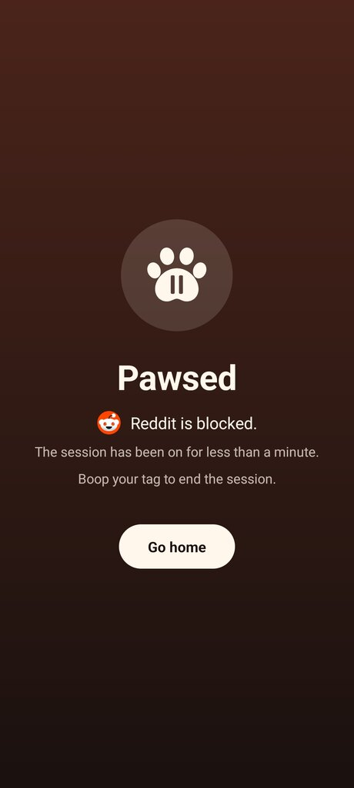
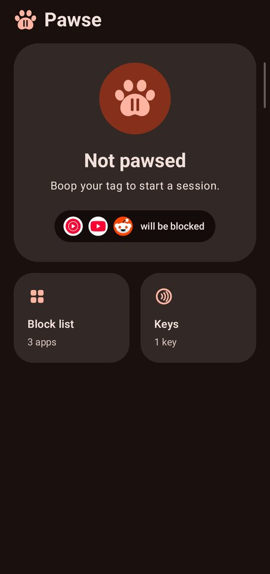

# Pawse

A focus mode for Android: chosen apps are covered until you scan an NFC tag,
which is meant to live inside a plushie. Scan it to start, scan it to stop.

<p align="center">
  
  
</p>

`SPEC.md` is the specification; its section 9 records the decisions, section
10 what the phone has answered, and section 11 the order of work. Milestones 1
to 5 are built: a tag starts and ends a session, a session covers the apps on
the block list, hides their notifications and pauses their sound, and the home
screen says what is missing before one can start.

## Installing

Signed builds are published as
[releases](https://github.com/JandoBR/pawse/releases) by CI on every
push that changes the app. Each one installs over the last. A build made with
`assembleDebug` is a separate app, "Pawse debug" (`uk.pixxula.pawse.debug`),
which installs beside a release and has its own settings and services.

On a Xiaomi phone, allow Pawse **Autostart** (Security, Permissions,
Autostart). Without it, clearing recents stops Pawse and MIUI will not let its
services start again until the accessibility service is switched off and on.

## Building

Release builds are signed with Pawse's own key, which CI holds as repository
secrets and which is backed up encrypted outside the repository. Without the
key in the environment, a release build falls back to the debug key, which
cannot update an installed copy.

Everything runs inside the Nix shell, which provides the JDK and the Android
SDK. Gradle is run through `nix-gradlew` so the build uses that SDK rather than
whatever happens to be installed.

```sh
nix develop
./nix-gradlew :app:testDebugUnitTest      # the unit tests
./nix-gradlew :app:assembleDebug          # app/build/outputs/apk/debug/app-debug.apk
adb install -r app/build/outputs/apk/debug/app-debug.apk
```

Then open Pawse and follow its checklist: the accessibility service,
notification access and the battery-saving exemption. The first is under
Settings, Accessibility, Downloaded apps. On
Android 13 and later a sideloaded app is refused there at first: open its
app-info page, and choose "Allow restricted settings" from the menu.

Do not check the app with `uiautomator dump`: it unbinds every accessibility
service on the phone while it runs, Pawse's included. Use screenshots, the
log (`adb logcat -s Pawse`) and the stored state
(`adb shell run-as uk.pixxula.pawse cat shared_prefs/session.xml`).
